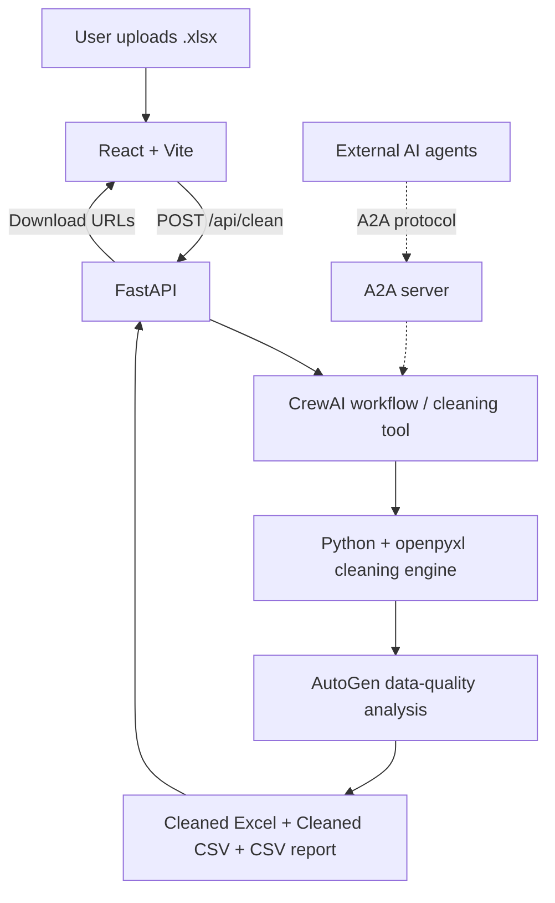

# CleanFlow AI

**AI-assisted Excel data cleaning with CrewAI, AutoGen, A2A, FastAPI, and React.**

> From messy spreadsheets to cleaner, more consistent data.

CleanFlow AI is a web application for uploading an Excel workbook, applying repeatable data-cleaning rules, reviewing data-quality findings, and downloading the results. Python performs the actual spreadsheet transformations; AI components coordinate the workflow and analyze data-quality summaries.

## Features

- Upload `.xlsx` workbooks through a React interface.
- Process all worksheets in a workbook.
- Remove fully blank rows and exact duplicate rows.
- Trim leading and trailing whitespace.
- Replace missing values in name-related fields (such as Name, Auditor, Client, or Patient) with `Unknown`.
- Replace missing values in applicable non-name, non-date fields with `N/A`.
- Detect column types and report invalid or suspicious values.
- Normalize supported date values; the UI offers `MM/DD/YYYY`, `DD/MM/YYYY`, and `MM-DD-YYYY` selections.
- Generate a cleaned Excel workbook, a cleaned CSV, and a CSV cleaning report.
- Show results on a dedicated results screen with download links.
- Include AI-assisted data-quality analysis using AutoGen and OpenAI.

**Date-format status:** In the previously implemented frontend, the date-format selector was a preview setting and was not yet wired into the backend request. Verify this integration before advertising selectable output formats as fully functional.

**CSV limitation:** The cleaned CSV contains the **first worksheet only**; the cleaned `.xlsx` workbook contains all processed sheets.

## Architecture



| Component | Purpose |
| --- | --- |
| **React + Vite** | Upload interface, cleaning settings, results and downloads |
| **FastAPI** | HTTP API for upload, processing and downloads |
| **CrewAI** | Coordinates the cleaning workflow and invokes the cleaning tool |
| **Python + openpyxl** | Performs deterministic Excel transformations |
| **AutoGen + OpenAI** | Analyzes cleaning statistics and generates recommendations |
| **A2A** | Makes the cleaning capability accessible to other compatible agents |

> The A2A server is a separate integration point; ordinary frontend uploads go through FastAPI.

## Example

**Before**

| Name | City | Date |
| --- | --- | --- |
| ` Alice ` | Chennai | `2026-10-21` |
| *(blank)* | Salem | `2026-10-20` |
| Ravi | *(blank)* | `2026-10-19` |
| Ravi | *(blank)* | `2026-10-19` |

**After** (illustrative output with `MM/DD/YYYY` formatting enabled)

| Name | City | Date |
| --- | --- | --- |
| Alice | Chennai | `10/21/2026` |
| Unknown | Salem | `10/20/2026` |
| Ravi | N/A | `10/19/2026` |

The cleaning engine trims whitespace, fills applicable blanks, removes the exact duplicate and normalizes supported dates.

## Technology stack

- **Backend:** Python 3.12, FastAPI, Uvicorn, openpyxl
- **AI orchestration:** CrewAI
- **AI analysis:** AutoGen, OpenAI (`gpt-4o-mini`)
- **Agent interoperability:** A2A SDK
- **Frontend:** React, Vite, JavaScript, CSS
- **Testing:** pytest
- **Deployment target:** Docker Compose on Hostinger VPS (planned / verify in repository)

## Project structure

The following paths reflect the project organization discussed during development; inspect your repository for the definitive file list.

```text
crewai-autogen-a2a/
├── app/
│   ├── api/
│   │   └── main.py
│   ├── agents/
│   │   ├── crewai/
│   │   │   ├── coordinator.py
│   │   │   ├── tasks.py
│   │   │   ├── workflow.py
│   │   │   └── excel_tool.py
│   │   ├── autogen/
│   │   │   ├── data_quality_agent.py
│   │   │   └── report_analyzer.py
│   │   └── a2a/
│   │       ├── excel_executor.py
│   │       └── server.py
│   ├── services/
│   │   ├── excel_cleaner.py
│   │   └── report.py
│   └── config.py
├── frontend/
│   ├── src/
│   │   ├── App.jsx
│   │   ├── App.css
│   │   └── index.css
│   └── vite.config.js
├── tests/
└── README.md
```

## Run locally

### Prerequisites

- Python **3.12**
- Node.js and npm
- An OpenAI API key for AI-enabled analysis

### 1. Backend setup

From the repository root:

```bash
python3.12 -m venv venv312
source venv312/bin/activate
pip install -r requirements.txt
```

If your repository does not yet have a `requirements.txt`, generate and review one from the actual working environment rather than guessing dependency versions.

Configure the OpenAI key using the environment-variable mechanism implemented in `app/config.py` (typically a local `.env` file):

```dotenv
OPENAI_API_KEY=your_openai_api_key_here
```

**Never commit your `.env` file or real API keys.**

Start FastAPI:

```bash
python -m uvicorn app.api.main:app --host 127.0.0.1 --port 8001
```

Check the backend at <http://127.0.0.1:8001/health>.

### 2. Frontend setup

Open a second terminal:

```bash
cd frontend
npm install
npm run dev
```

Open <http://localhost:5173>.

The Vite development proxy forwards `/api` requests to `http://127.0.0.1:8001`.

**Troubleshooting:** If Vite reports `ECONNREFUSED 127.0.0.1:8001`, make sure the FastAPI backend is running on port `8001`.

## How to use

1. Open the frontend in your browser.
2. Select an `.xlsx` workbook.
3. Choose the date format shown in the interface (verify backend integration before relying on this setting).
4. Click **START CLEANING**.
5. Wait for processing to finish.
6. On the Results screen, download the cleaned Excel workbook, cleaned CSV, or cleaning report.
7. Use **BACK TO UPLOAD** to process another workbook.

## API reference

| Method | Endpoint | Description |
| --- | --- | --- |
| `GET` | `/health` | Backend health check |
| `POST` | `/clean` | Upload and clean an `.xlsx` file |
| `GET` | `/download/{job_id}/excel` | Download cleaned Excel |
| `GET` | `/download/{job_id}/cleaned-csv` | Download cleaned CSV (first sheet) |
| `GET` | `/download/{job_id}/csv` | Download CSV cleaning report |

The frontend uses the `/api` prefix, which Vite removes before forwarding requests to FastAPI during local development.

Example successful cleaning response:

```json
{
  "job_id": "example-job-id",
  "cleaned_excel_url": "/download/example-job-id/excel",
  "cleaned_csv_url": "/download/example-job-id/cleaned-csv",
  "csv_report_url": "/download/example-job-id/csv"
}
```

The exact response fields may include additional metadata. Confirm against `app/api/main.py`.

## Testing

Run backend tests from the repository root:

```bash
source venv312/bin/activate
python -m pytest -q
```

Build the frontend:

```bash
cd frontend
npm run build
```

Prefer mocked LLM responses in automated tests to avoid unexpected OpenAI API costs.

## Docker and Hostinger deployment

**Deployment is a planned phase; do not treat it as completed until Docker files, container tests, VPS configuration and HTTPS have been verified.**

Recommended deployment flow:

```text
Test locally → Dockerize frontend and backend →
Push to GitHub → Deploy with Docker Compose to Hostinger VPS →
Configure custom domain → Enable HTTPS
```

Production considerations:

- Serve the React production build through Nginx or the existing reverse proxy.
- Proxy `/api` to the backend container.
- Keep OpenAI credentials outside source code and images.
- Persist generated files long enough for downloads and apply a retention policy.
- Inspect existing VPS services and occupied ports before deploying.
- Reuse the existing reverse proxy where appropriate; do not interrupt unrelated containers.
- Restrict external A2A access unless explicitly needed and secured.
- Verify uploads, cleaning, downloads, domain routing and HTTPS end-to-end.

## Known limitations and verification checklist

- [ ] Confirm date-format selection is connected to the backend and applies per request.
- [ ] Confirm all three download links work after a fresh upload.
- [ ] Confirm cleaned CSV exports only the first sheet, as documented.
- [ ] Confirm invalid dates are reported rather than silently misinterpreted.
- [ ] Confirm AI analysis does not send unnecessary sensitive spreadsheet contents to OpenAI.
- [ ] Verify A2A server startup and agent-card discovery using the actual SDK version.
- [ ] Verify Docker Compose, Hostinger deployment, custom domain and HTTPS when implemented.

## Security

- Keep `.env`, keys, uploaded workbooks and generated reports out of Git.
- Validate uploaded file types and sizes.
- Use unique job identifiers and restrict file downloads to intended job outputs.
- Treat uploaded workbooks as untrusted content.
- Set an appropriate file-retention and cleanup policy.
- Avoid exposing private spreadsheet data in application logs or AI prompts.

## Author

**Prakash R**  
Email: [prakashramasamy97@gmail.com](mailto:prakashramasamy97@gmail.com)

---

*CleanFlow AI — Clean data. Clear results.*
